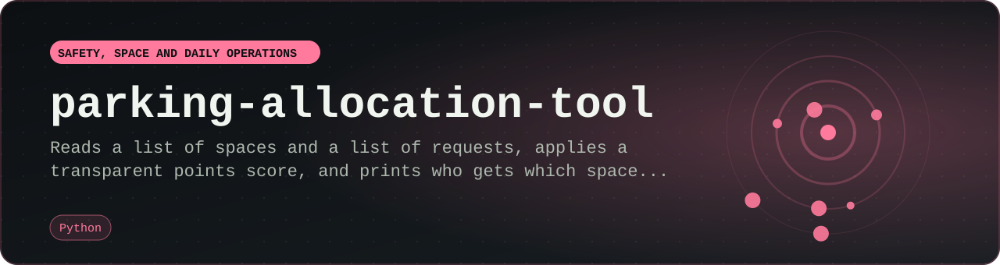
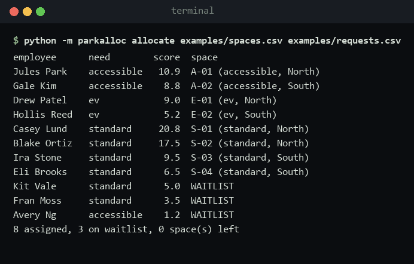

<p align="center"></p>

# parking-allocation-tool

Assigning a limited number of parking spaces is a fairness problem: people with an accessibility need must be served first, EV drivers need chargers, and everyone else should rotate fairly. This repo reads a list of spaces and a list of requests, applies a transparent points score, and prints who gets which space and who goes on the waitlist.



## What it is for

Facility teams that hand out permits each month or each semester usually decide by hand and by memory. Use this tool to run the same rules every time: accessible need first, EV need next, then a points score for time spent waiting, carpooling and commute distance. Results can be repeated with the same seed and exported to CSV for the permit office.

## Install

```
git clone https://github.com/yassine2med/parking-allocation-tool
cd parking-allocation-tool && pip install -r requirements.txt
```

## How to use

| I want to | Command |
|---|---|
| Allocate spaces and see the waitlist | `PYTHONPATH=src python -m parkalloc allocate examples/spaces.csv examples/requests.csv` |
| Repeat or vary the tie-break | `PYTHONPATH=src python -m parkalloc allocate examples/spaces.csv examples/requests.csv --seed 42` |
| Save the result as CSV | `PYTHONPATH=src python -m parkalloc allocate examples/spaces.csv examples/requests.csv --out result.csv` |
| Show help | `PYTHONPATH=src python -m parkalloc --help` |

Exit codes: 0 when everyone got a space, 1 when at least one request is on the waitlist, 2 for a missing file or bad data.

Example:

```
PYTHONPATH=src python -m parkalloc allocate examples/spaces.csv examples/requests.csv
```

Output:

```
employee      need        score  space
Jules Park    accessible   10.9  A-01 (accessible, North)
Gale Kim      accessible    8.8  A-02 (accessible, South)
Drew Patel    ev            9.0  E-01 (ev, North)
Hollis Reed   ev            5.2  E-02 (ev, South)
Casey Lund    standard     20.8  S-01 (standard, North)
Blake Ortiz   standard     17.5  S-02 (standard, North)
Ira Stone     standard      9.5  S-03 (standard, South)
Eli Brooks    standard      6.5  S-04 (standard, South)
Kit Vale      standard      5.0  WAITLIST
Fran Moss     standard      3.5  WAITLIST
Avery Ng      accessible    1.2  WAITLIST
8 assigned, 3 on waitlist, 0 space(s) left
```

Run the tests with `python -m pytest -q`.

## How it works

1. Spaces have a type (`standard`, `accessible`, `ev`) and a zone. Requests have a need, a carpool flag, weeks waiting and commute miles.
2. Score = 2 points per week waiting + 3 for carpooling + 1 per 10 commute miles, capped at 5.
3. Requests are processed in this order: accessible, EV, standard. Within a group the highest score gets the first free space of that type.
4. An EV request with no free EV space falls back to a standard space. An accessible request never falls back, and a standard request never takes an EV or accessible space.
5. Exact score ties are broken by a shuffle seeded with `--seed` (default 0), so the same input and seed always give the same answer.

## Limits

- One space per request; no zone preferences or pairing of vehicles.
- The score weights are constants in `src/parkalloc/core.py`; edit them to match your policy.
- It does not check whether an accessibility need is documented. That is a decision for your office.

## License

MIT. Yassine Emhamed, 2026.
